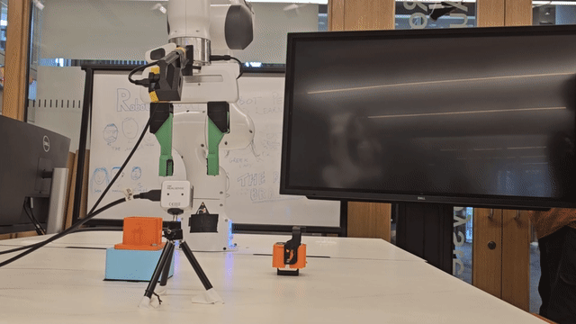
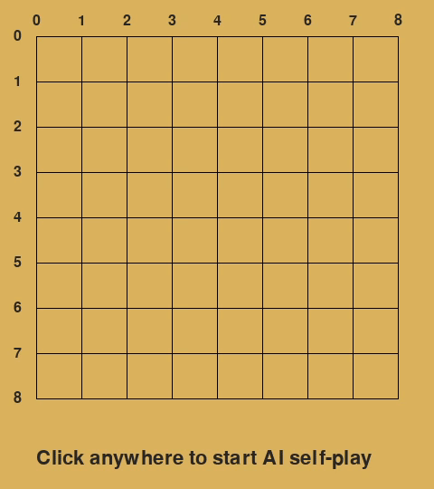

# Kishan Grewal

Second year robotics student at UCL.

## Franka Panda VLA Deployment · vla-teleop-franka-v2

  

**Closed-loop VLA policy deployment for autonomous MSD plug insertion** · `Python · LeRobot`  
**XR teleoperation and data collection on a 7-DOF Franka Panda** · `C++ · libfranka`  

## Inverted Pendulum Balancing Robot · inverted-pendulum-cart

  

**Custom-built cart, full-state LQR + Kalman filter** · `C++ · Arduino Giga R1`  

## Mini Quadruped Robot · mini-pupper-ros

  

**Person-tracking robot dog with YOLO11n detection and IMU control** · `Python · ROS 2`  

**Autonomous navigation with SLAM Toolbox and Nav2** · `Nav2 · SLAM Toolbox · ROS 2`  

**Multi-robot fleet control with EKF to correct quadruped gait drift** · `C++ · ROS 2`  

## Reinforcement Learning · deep-rl-locomotion · alphazero-gomoku-9x9

  

**Half-Cheetah RL with Gym in Mujoco (PPO, SAC, MBPO)** · `Python · PyTorch`  

  

**AlphaZero Gomoku** · `Python · PyTorch`  

